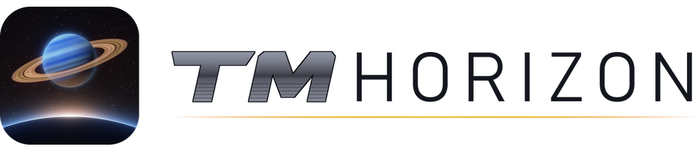
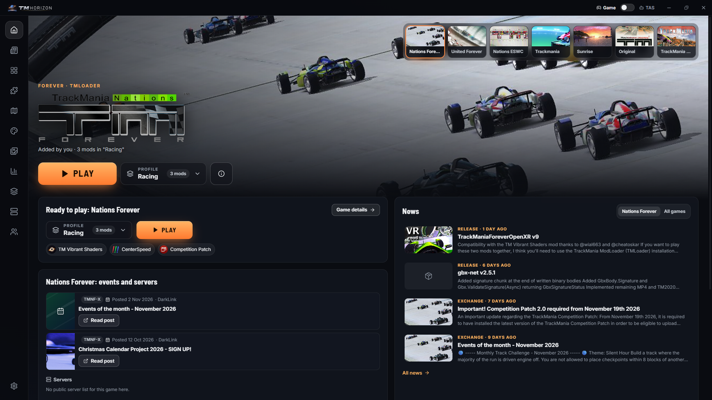
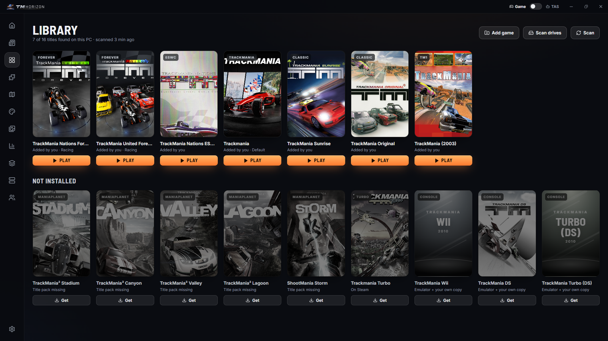
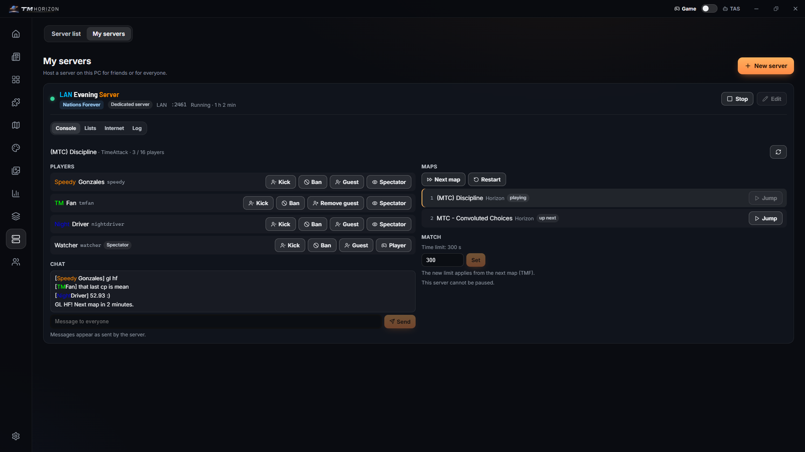
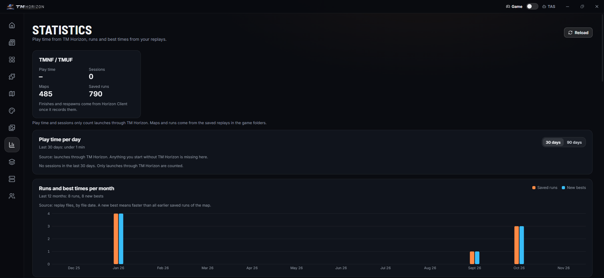

<p align="center"><picture><source media="(prefers-color-scheme: dark)" srcset="docs/brand/wordmark-dark.png"></picture></p>

# TM Horizon

**One launcher for every TrackMania game on Windows, from TrackMania (2003) to Trackmania (2020): your library, mods, maps, servers and statistics in one place.**

It also installs and updates the other TM Horizon projects: [Horizon Client](https://github.com/cheatoskar/horizon-client) (an in-game menu with modules for Nations ESWC, Sunrise, Original and, experimentally, Nations/United Forever), [Legacy Essentials](https://github.com/cheatoskar/eswc-autosave) and [TM Vibrant Shaders](https://github.com/cheatoskar/TM-Vibrant-Shaders).

Version 0.5.1 is the **Launcher Preview** for Windows: expect rough edges and tell me what breaks in the [issues](https://github.com/cheatoskar/tm-horizon/issues). Licence: AGPL-3.0 ([LICENSE](LICENSE)).

**[Download the latest release](https://github.com/cheatoskar/tm-horizon/releases/latest)** · [Install](#install-windows) · [Features](#features) · [Games](#what-works-in-which-game) · [Privacy](#privacy) · [Known issues](#known-issues) · [Build](#build) · [TM Horizon family](#tm-horizon-family)



---

## TM Horizon family

Six projects, built to work together. TM Horizon installs and updates the others where it can; each one also works without it.

| Project | What it is | Games | How to get it | Repo |
|---|---|---|---|---|
| **TM Horizon** (this repo) | Launcher for every TrackMania game on Windows: library, mods, maps, servers, statistics. Installs and updates Horizon Client, Legacy Essentials and TM Vibrant Shaders. | All, from TrackMania (2003) to Trackmania (2020) | Installer from the releases (0.5.1, Launcher Preview) | [cheatoskar/tm-horizon](https://github.com/cheatoskar/tm-horizon) |
| **Horizon Client** | In-game menu and mod loader with modules: Legacy Essentials, TMX Browser, TMX Upload, WR Hunter, Input Display, Horizon Performance, Horizon Scripts. | ESWC, Sunrise, Original; TMNF and TMUF through TMLoader (experimental) | TM Horizon (game page), or a zip per game (0.3.1) | [cheatoskar/horizon-client](https://github.com/cheatoskar/horizon-client) |
| **Legacy Essentials** | Autosave, controller fix, login fix and game settings. A standalone `dinput8.dll` mod with its own menu (`Ctrl+F2`). The same features are the "Legacy Essentials" group in Horizon Client. | ESWC, Sunrise, Original | A zip per game (1.3.1); TM Horizon installs it on ESWC | [cheatoskar/eswc-autosave](https://github.com/cheatoskar/eswc-autosave) |
| **Legacy Randomizer** | Random Map Challenge with maps from TMX, inside the game. A Horizon Client module. | ESWC, Sunrise, Original (solo) | A zip with Horizon Client, or the plugin alone (0.3.1) | [cheatoskar/legacy-randomizer](https://github.com/cheatoskar/legacy-randomizer) |
| **TM Vibrant Shaders** | Lighting, weather, skies, photos, clips and video export. Standalone, or as four Horizon Client modules. | TMNF, TMUF, TM2; ESWC, Sunrise, Original experimental | Setup or ModLoader server (1.6.0), Horizon modules zip (2.0.0); TM Horizon installs it on TMNF, TMUF and ESWC | [cheatoskar/TM-Vibrant-Shaders](https://github.com/cheatoskar/TM-Vibrant-Shaders) |
| ***For developers*** | | | | |
| **trackmania-internals** | Notes for mod developers: addresses, structures, file formats and physics of the games. | TMNF, TMUF, ESWC, Sunrise, Original, ManiaPlanet | Read it on GitHub | [cheatoskar/trackmania-internals](https://github.com/cheatoskar/trackmania-internals) |

TMNF/TMUF = TrackMania Nations/United Forever, ESWC = TrackMania Nations ESWC, TM2 = TrackMania 2 (ManiaPlanet).

- **Legacy Essentials or Horizon Client:** one is enough. Horizon Client has the same features in its "Legacy Essentials" group. With both in one game, the standalone keeps the autosave (the client's Autosave module pauses itself and logs `standalone ESWC Autosave found (eswc_autosave.dll): module paused`), and the login fix, controller fix, game settings and menu are the client's.
- **TM Vibrant Shaders standalone or as Horizon modules:** one of the two. With both installed, the one the game loads first runs and the other stays off.

---

## Install (Windows)

1. Download `TM-Horizon_0.5.1_x64-setup.exe` from the [latest release](https://github.com/cheatoskar/tm-horizon/releases/latest) and run it. It installs for your user only, no admin needed. `SHA256SUMS` in the release has the checksums if you want to check the download.
2. The installer is not code-signed (a certificate costs money), so SmartScreen shows "Windows protected your PC". Click "More info", then "Run anyway".
3. TM Horizon looks for your games (Steam, Ubisoft Connect, Epic, the folders you add, a drive scan). A game it does not find can be added with "Add folder" in the library.

Updates come through the app (Settings > Updates: channel Stable or Beta, "Check at start", "Install updates automatically") and are checked against my signing key. An update installs when you close TM Horizon or at the next start, never while a game runs; a button in the title bar shows a waiting update, and "What's new" shows the notes afterwards.

Linux packages exist in the build setup ([apps/launcher/docs/linux.md](apps/launcher/docs/linux.md), [packaging/arch/](packaging/arch/)) but are not part of this preview.

---

## Features

The left bar has these pages: Home, News, Library, Mods, Maps, Skins & mods, Media, Statistics, Profiles, Servers, Community, Settings. A switch in the title bar changes between **Game** and **TAS** mode.

| | |
|---|---|
| **Library and Play** | Every TrackMania on your PC (Steam, Ubisoft Connect, Epic, own folders, drive scan), each copy and instance on its own. A page per game with Play, the TMLoader profile to start with, mods, maps and links. Play on Home starts the game at once with the selected profile. "More projects" on a game page lists other community projects for that game. |
| **Mods** | TMLoader mods from the TMLoader servers, checked against the servers' SHA-256. Mods from their authors' GitHub releases. Openplanet plugins: Install, Update and Remove with one click (Mods page, plugin page, game page). The TMX browser add-on. What TM Horizon changed in a game's folders is listed under History, with a backup first. |
| **TMLoader profiles** (TMNF, TMUF) | Create, switch and start profiles. Share a profile as a `tmhub://pack/` link or a `.tmhubpack` file; importing checks every mod against your TMLoader servers and installs with SHA-256. |
| **Horizon Client** | On the game page of ESWC, Sunrise and Original: switch Horizon Client on, and TM Horizon downloads its GitHub release and checks every file. On TMNF and TMUF it goes into the TMLoader profiles you pick, as the product "Horizon Client" (experimental). Modules are switched on the game page (Forever: per TMLoader profile) and on the Mods page under "Horizon modules". A game paired with TM Horizon can open a map in the running game and hand new replays to TMX Upload. |
| **Legacy Essentials, TM Vibrant Shaders** | ESWC game page: install, update, remove and restore Legacy Essentials (shown as "ESWC Autosave") and the TM Vibrant Shaders `d3d9.dll`, from their GitHub releases. Legacy Essentials is only offered for copies without Horizon Client, never for StarForce copies. TM Vibrant Shaders for TMNF and TMUF comes through the TMLoader servers. |
| **Maps and skins** | The Exchange sites and ManiaPark inside the app; downloads go straight into the game folders. Play from TMX: the map opens in the game (ESWC, Sunrise and Original through Horizon Client). "Installed skins & mods" lists what ManiaPark put into your game folders, with On/Off and Remove. |
| **Map tools** | Map details: open a map `.Gbx` offline and see medals, checkpoints, the block list, a 3D view and the build order. Opened from Map tools, your downloaded maps and the Statistics table. "Open .Gbx files with TM Horizon" (off by default, in Settings): a double-click on a map or replay asks which copy of the game to start. |
| **Statistics** | From your own replays, for every copy of a game (Steam, Ubisoft, own folders, instances), with a filter per copy. Map table with filters (also "No respawns"), campaign badge and map pictures. Play time, also for games started without the launcher while TM Horizon is open; Nations/United Forever also show the play time from before TM Horizon (read from the game profiles). |
| **Media** | Clips and screenshots of your games. Recording clips needs TM Vibrant Shaders or TM Clips. |
| **Servers** | Live list with players and maps, read from the servers themselves; all servers are asked at once and rows appear as they answer. Your own dedicated server for Nations/United Forever in a few clicks: ports, router (UPnP), firewall rule, console with players, chat and maps. |
| **Game tools** | Steam fix for United Forever (makes it behave like the stand-alone version and installs Nadeo's last update). TrackMania Highlands from ModDB (you download it, the launcher installs it). Skid marks on Nations/United Forever as a TMLoader product, without admin rights (experimental). Openplanet setup with the official installer. Health check (game, helpers, user folder, disk; changes nothing). Back up player data (profiles, game settings and local records of Forever, as one zip). Performance page with DXVK (Vulkan, experimental). |
| **Report** | "Report" on each game page: logs of the profile's mods, the newest crash logs and a system summary, redacted, zipped to the Desktop or Downloads. Nothing is uploaded. |
| **TAS mode** | Only TAS things: TMInterface (Forever, started through a TMLoader profile with TMInterface + CoreMod), ForeverTAS, a placeholder for the Trackmania (2020) tool "Tick", TAS profiles and TMTAS Exchange. Offline only: no server joins, the first start shows "Offline only". Game mode shows no TAS UI and never offers a TMInterface profile. |
| **Comfort** | Languages: English, Deutsch, Polski, Français (Settings > Language, "Like Windows" by default). "Show what I play in Discord" (off by default): the game you play and "In TM Horizon" while the launcher is open, also for games started outside it ([docs/discord-presence.md](docs/discord-presence.md)). |

| | |
|---|---|
| Library |  |
| Own server, console |  |
| Statistics |  |

---

## What works in which game

✓ = works, experimental = works but not well tested, – = not available.

| | TMNF / TMUF | ESWC | Sunrise | Original | TM2 / ShootMania | Trackmania (2020) | Turbo | TM (2003), Wii, DS |
|---|---|---|---|---|---|---|---|---|
| Library, game page, Play | ✓ | ✓ | ✓ | ✓ | ✓ (title packs or the store) | ✓ (store) | ✓ (store) | where to get it, emulator setup for your own copy |
| TMLoader profiles and mods | ✓ | – | – | – | – | – | – | – |
| Openplanet setup and plugins | – | – | – | – | ✓ | ✓ | ✓ | – |
| Horizon Client | experimental (TMLoader) | ✓ | ✓ | ✓ | – | – | – | – |
| Legacy Essentials | – | ✓ | by hand | by hand | – | – | – | – |
| TM Vibrant Shaders | ✓ (TMLoader) | ✓ (`d3d9.dll`) | by hand | by hand | its own setup | – | – | – |
| Own dedicated server | ✓ | – | – | – | – | – | – | – |
| Steam fix, Highlands, skid marks | ✓ | – | – | – | – | – | – | – |
| TAS tools | ✓ (TMInterface, ForeverTAS) | – | – | – | – | placeholder ("Tick") | – | – |

"By hand" and "its own setup": the project works in that game, but TM Horizon 0.5.1 does not install it there yet; use the project's release.

---

## Privacy

No account, no telemetry. The launcher loads the mod list from tm-horizon.com (the hub's signed index), the "More projects" lists, and covers and map pictures through its image proxy; that server sees your IP address. Everything else stays on your PC. Apart from that it only contacts the services you use through it (GitHub, the Exchange sites and ManiaPark, Openplanet, the TMLoader mod servers, Steam and IGDB for covers, Nadeo's download servers, the game servers in your list); like any website they see your IP address. The full list: [docs/release/outbound-hosts.md](docs/release/outbound-hosts.md).

Not affiliated with Ubisoft or Nadeo. TrackMania is a trademark of Ubisoft.

---

## Safety rules in the code

- Nothing inside `Program Files (x86)\TrackMania Nations ESWC` (StarForce) is ever opened, listed or started (`apps/launcher/src-tauri/src/fsx.rs`, resolved paths, tested).
- A `dinput8.dll` is written only for Horizon Client and Legacy Essentials, only into a scanned game folder or one of TM Horizon's own instances, after you confirmed the list of files, with a backup first (`horizonhost.rs`, `eswcmods.rs`, `catalogmods.rs`).
- TMLoader files are written only while TMLoader and the game are closed, with a backup first, atomically, one write at a time.
- Downloads: https only (TMUF's official setup is plain http and ships with its known SHA-256), mod zips checked against the index SHA-256, size caps.
- `tmhub://` links are registered only after you agree.
- TAS tools stay offline, and Game mode never offers a TMInterface profile.
- Windows Defender: TM Horizon never adds exclusions or changes Defender settings. When a start fails because Defender blocks a file, it says which file and links to Windows Security (`defender.rs`).

---

## Known issues

- **SmartScreen** warns about the installer because it is not code-signed: "More info", then "Run anyway".
- **Windows Defender and TMLoader:** since 2026-11-12 Defender flags `TMLoader.exe` itself (TMLoader, not TM Horizon) as a potentially unwanted app, so Nations/United Forever started through TMLoader may not start. TM Horizon then says "Windows Defender blocks TMLoader.exe." with a button that opens Windows Security, where the block is listed under Protection history. Whether you allow it there is your decision.
- **TrackMania Sunrise** has no online servers any more.
- Horizon Client on Nations/United Forever, skid marks and DXVK are experimental.
- Report bugs in the [issues](https://github.com/cheatoskar/tm-horizon/issues); for a game problem attach the zip from "Report" on its game page.

---

## Layout

| Folder | What | Stack |
|---|---|---|
| `apps/launcher` | The launcher: library of installed games, Play with TMLoader profiles, mod installs from the TMLoader servers, TMX / ManiaPark / TMTAS / RPG Trial inside the app, clips, servers and events, packs, problem reports, Discord status | Tauri 2 (Rust, `src-tauri/`) + React/Vite/TS |
| `apps/web` | The website (English, Deutsch, Polski, Français): games, mods, servers, events, communities, directory | Astro (static) |
| `packages/api` | Data pipeline: TMLoader indexes, GitHub, TMX, ManiaPlanet and trackmania.io servers, community server registry and event submissions (GitHub issue forms), Discord events, community Discord directory -> `dist/*.json` | Node 24 + TypeScript (runs `.ts` directly) |
| `packages/shared` | Hub data types (`src/types.ts`, the shapes of `packages/api/dist`) and design tokens (`tokens.css`, `src/tokens.ts`) used by launcher and website | TS |
| `packages/catalog` | Researched catalog of sites, mods, tools and communities (`catalog.json`, checker scripts) | JSON + Python |
| `docs/` | `release.md` (how a release is made), `release/` (release notes, outbound hosts), `mod-publishing.md` (design of mod publishing), `discord-presence.md` | |
| `.github/` | CI (`ci.yml`), release build (`release.yml`, see `docs/release.md`), daily mod link check (`links.yml`), hourly hub data build (`hub-data.yml`), issue forms for servers and events and the workflow that turns approved ones into pull requests (`registry.yml`) | |

npm workspaces tie it together: one `npm install` at the root, one `package-lock.json`.

## Build

Node 24, Rust (`%USERPROFILE%\.cargo\bin`), Python 3 for the art and catalog scripts.

```
npm install                              # all workspaces
npm run typecheck                        # shared, api, launcher
npm test -w @tm-hub/api                  # pipeline tests (parsers, registry files, dist against schemas)
npm run build -w @tm-hub/api             # -> packages/api/dist (network sources may fail; cached/sample data is used)
npm run hub-data                         # copies packages/api/dist into the launcher's bundled fallback

# website
python apps/web/scripts/fetch-game-art.py   # once: store/box art (not committed)
npm run build -w @tm-hub/web                # -> apps/web/dist

# launcher
cd apps/launcher
npm run build                            # web UI only (also runs in a normal browser as a preview), with the preview art
npm run build:public                     # same without the preview-only art (what releases use, docs/release.md)
cd src-tauri && cargo test               # Rust unit tests
cd .. && npx tauri build                 # -> src-tauri/target/release/bundle/nsis/TM Horizon_<version>_x64-setup.exe
# Linux (docs: apps/launcher/docs/linux.md, Arch: packaging/arch/)
npx tauri build --bundles appimage,deb,rpm
# a Tauri build runs `npm run build`; set TMHUB_PUBLIC_BUILD=1 to get the public art set,
# TMHUB_RELEASE_PREVIEW=1 for the Launcher Preview (public build without any hub feature, docs/release.md)
```

Testing against a copy of TMLoader instead of the real one: `TMHUB_TMLOADER_DIR=<copy>` (the launcher then shows "Sandbox"), `TMHUB_SANDBOX=<copy> TMHUB_NET_TESTS=1 cargo test` for the network tests.

How a release is made: [docs/release.md](docs/release.md). Release notes: [docs/release/](docs/release/). Changes: [CHANGELOG.md](CHANGELOG.md).

## What is real

Everything the launcher shows comes from real sources: the games on this PC, TMLoader profiles and mods, the TMLoader server indexes with SHA-256, GitHub releases, the Exchange sites, Openplanet's plugin list, the catalog (link-checked, filtered by licence in public builds: `packages/catalog/release-policy.json`) and the game servers' own answers. The sample data in `apps/launcher/src/data/sample.ts` is only for the browser preview; a public build fails if any of it is in the bundle (`apps/launcher/vite.config.ts`).

---

## Credits

- Built with [Tauri](https://tauri.app), [React](https://react.dev), [Vite](https://vite.dev) and [Astro](https://astro.build); icons from [Lucide](https://lucide.dev).
- Maps, pictures and records come from the Exchange sites and ManiaPark, plugins from Openplanet, through their public APIs.
- [TMLoader](https://tomashu.dev/software/tmloader/) by tomashu, the TMLoader mod servers and every mod author whose work the launcher lists. Art sources and their status: [ART_CREDITS.md](ART_CREDITS.md).
- TrackMania is a trademark of Ubisoft / Nadeo. This is a fan project and has nothing to do with them.

## Licence

AGPL-3.0 ([LICENSE](LICENSE)).
